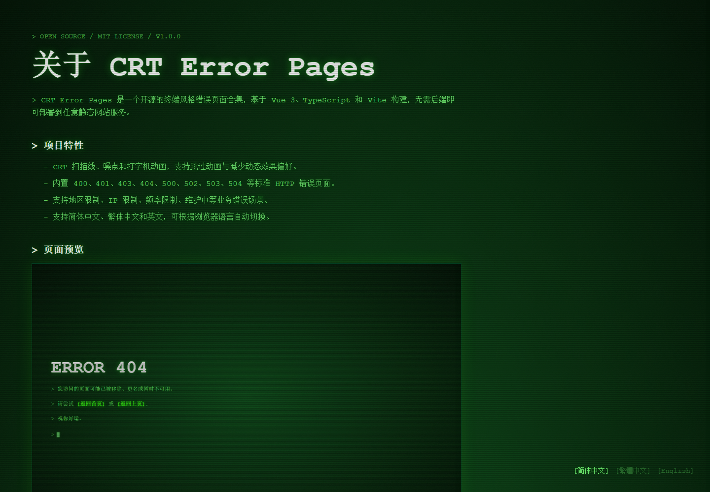

# CRT Error Pages

开源的 CRT 终端风格错误页面合集，基于 Vue 3、TypeScript 和 Vite 构建。无需后端，即可部署到任意静态网站服务。

当前版本：**1.0.0**

许可证：[MIT](LICENSE)

## 截图

| 桌面端 404 | 移动端 404 | 项目介绍 |
| --- | --- | --- |
|  |  |  |

## 功能

- CRT 扫描线、噪点、荧光文字和打字机动画
- 支持跳过动画与 `prefers-reduced-motion`
- 内置 `400`、`401`、`403`、`404`、`500`、`502`、`503`、`504` 错误页面
- 内置地区限制、IP 限制、频率限制、维护中等业务错误页面
- 支持简体中文、繁体中文和英文自动切换
- 支持通过 URL 参数自定义标题、描述、代码和跳转链接
- 支持可配置的域名白名单
- 纯前端项目，无后端、数据库或外部 API 依赖

## 快速开始

要求：Node.js 20.19+ 或 22.12+。

```bash
git clone https://github.com/TBDengTa/crt-error-pages.git
cd crt-error-pages
npm install
npm run dev
```

本地开发地址默认为 `http://localhost:5173`。

## 页面路由

| 路由 | 说明 |
| --- | --- |
| `/{code}` | 标准 HTTP 错误页，例如 `/404`、`/500` |
| `/custom?type={type}` | 自定义业务错误页 |
| `/about` | 项目介绍、使用说明和配置文档 |

支持的 `type`：

- `geo-blocked`
- `ip-blocked`
- `rate-limited`
- `maintenance`
- `service-unavailable`
- `gateway-timeout`

## 自定义参数

| 参数 | 说明 |
| --- | --- |
| `title` | 自定义标题 |
| `message` | 自定义描述 |
| `code` | 自定义显示代码 |
| `home_url` | 自定义“返回首页”链接 |
| `contact_url` | 自定义“联系支持”链接 |
| `lang` | 强制语言：`zh-CN`、`zh-TW`、`en` |

示例：

```text
/404?title=页面走丢了&message=请检查地址后重试&lang=zh-CN
/custom?type=maintenance&title=系统升级中&code=UPGRADE
/403?lang=en
```

`title`、`message`、`code`、`home_url`、`contact_url` 和 `type` 仅在允许的域名下生效；`lang` 始终可用。

## 域名配置

复制环境变量示例：

```bash
cp .env.example .env.local
```

编辑 `.env.local`：

```dotenv
VITE_ALLOWED_DOMAINS=localhost,127.0.0.1,example.com,www.example.com
```

本地默认允许 `localhost` 和 `127.0.0.1`。部署到自己的域名时，请将域名加入白名单。

如需允许所有域名，可设置为：

```dotenv
VITE_ALLOWED_DOMAINS=*
```

公共部署不建议使用 `*`，以免页面内容被第三方 URL 参数覆盖。

## 构建与部署

```bash
npm run build
npm run preview
```

构建产物位于 `dist/`。将其部署到 Nginx、Apache、Vercel、Netlify、GitHub Pages 等静态服务时，需要配置 SPA 回退，将所有路由指向 `index.html`。

Nginx 示例：

```nginx
location / {
    try_files $uri $uri/ /index.html;
}
```

## 技术栈

- Vue 3
- TypeScript
- Vite
- Vue Router
- Tailwind CSS

## 参与贡献

欢迎提交 Issue 或 Pull Request：

https://github.com/TBDengTa/crt-error-pages/issues

## 许可证

本项目基于 [MIT License](LICENSE) 开源。
